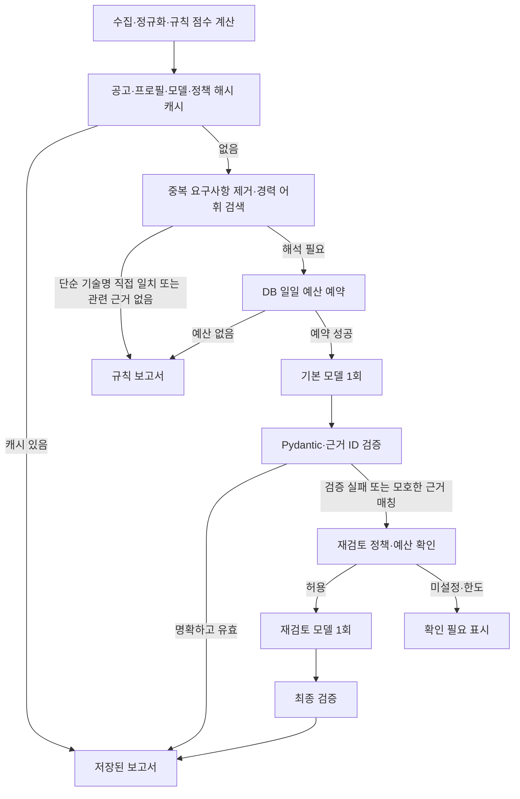

# 수집 공고의 비용 제한 AI 분석

채용 사이트에서 정규화해 수집한 공고와 구조화된 경력 근거를 비교하는 시스템이다.
LLM은 규칙 기반 적합도 점수를 수정하지 않고 요구사항별 해석과 준비 행동을 보완한다.
현재 구현은 LangChain Core, LangGraph, Pydantic, SQLAlchemy/PostgreSQL을 사용한다.

## 실행 구조



LangChain Core는 프롬프트/메시지를 구성한다. LangGraph는 `prepare`, `fast`, `review`,
`finalize` 노드와 조건부 엣지를 실행한다. 모델별 HTTP 연결은 `LocalAIClient`가 담당한다.
워크플로는 고정된 최대 깊이와 호출 횟수를 사용하며, 무제한 자율 에이전트 루프는 없다.

## 비용을 제한하는 방법

| 항목 | 기본 정책 |
|---|---|
| 요구사항 추출 | 이미 정규화된 필드에서 규칙 추출, LLM 0회 |
| 모델에 넣는 요구사항 | 필수 요건 우선, 중복 제거 후 최대 8개 |
| 경력 검색 | 단어 겹침 기반 lexical retrieval, 최대 10개, 항목당 최대 600자 |
| 전체 프롬프트 | 기본 12,000 UTF-8 바이트 이하, 낮은 관련도 근거부터 줄이고 최소 문맥도 초과하면 호출 생략 |
| 출력 | 기본 1,200 토큰 요청 |
| 공고별 호출 | 규칙 0회 / 일반 1회 / 재검토 포함 최대 2회 |
| 배치 | 새 분석 최대 10건, 상위 모델 재검토 최대 2건 |
| 일일 제한 | UTC 기준 예약량 100,000, 재검토 최대 5회 |
| 실패 | 연결 실패를 이유로 상위 모델에 재시도하지 않음 |
| 자동 실행 | 기본 꺼짐, `AI_ANALYSIS_AFTER_CRAWL=true`로 선택 |

Luna/Terra를 사용하는 Codex 설정 예:

```dotenv
AI_PROVIDER=codex
AI_ALLOW_REMOTE=true
AI_BASE_URL=http://host.docker.internal:48765
AI_ANALYSIS_FAST_MODEL=gpt-5.6-luna
AI_ANALYSIS_REVIEW_MODEL=gpt-5.6-terra
```

외부 전송에 동의한 사용자의 Git 제외 `.env`에만 설정한다. 공개 기본값은 로컬 모델이다.
모델명은 가격을 보장하는 속성이 아니므로 다른 제공자에서는 실제 저가/상위 모델명을 지정한다.
Codex 브리지는 서버에 등록한 모델만 허용하며, 대화용 Astra 선택이 저비용 분석에 전파되지 않는다.
모델 접근 권한은 해당 계정에 필요하다.

모호함은 모델의 임의 신뢰도 숫자가 아니라, 평가 결과에서 `partial` 또는 인용이 있으면서
`unknown`인 요구사항이 절반 이상인지를 기준으로 판단한다. 근거가 전혀 없는 `unknown`만으로
상위 모델을 호출하지 않는다. 재검토는 같은 제한된 근거를 다시 해석하며 새로운 사실을 검색하지 않는다.
`job_economy_graph_v2`부터 검증기의 오류 코드 또는 모호한 요구사항의 이전 판정·인용 ID를
`review_feedback`으로 전달하여 수정 방향을 알려 준다. 실패한 원문 응답, 자유 서술,
검증되지 않은 ID, 예외 메시지는 재입력하지 않는다. 재검토 가능 시 문맥 선택 단계에서
피드백용 2,000바이트 여유를 확보하고, 호출 직전에는 피드백을 포함한 실제 직렬화 크기로
입력 한도와 예약량을 검사한다. 입력이 최소 단위여도 한도를 넘으면 호출하지 않는다.

이는 코드 검증기를 이용한 **최대 1회 수정의 제한형 피드백 워크플로**다.
생성 → 검증 → 피드백 → 재생성 → 재검증의 순서를 기존 `fast`/`review` 노드에 펼쳐 구현했다.
그래프의 순환 엣지나 무제한 자율 에이전트, 별도 LLM 심판을 추가한 것은 아니다.
재검토가 다시 모호하거나 잘못되어도 세 번째 호출 없이 종료한다.

## 저장·동시성·관측

- `job_ai_analyses`: 입력·규칙 점수·제공자·엔드포인트·실제 기본 모델·재검토 모델·정책 버전
  해시를 비교하는 완료 결과 캐시. 같은 프로필에 대해 입력과 점수가 동일한 다른 소스의 공고도 재사용한다.
- `ai_analysis_days`: 날짜별 예산 예약량, 호출 횟수, 재검토 횟수. `INSERT ON CONFLICT`와
  조건부 `UPDATE`로 동시 요청의 예약을 원자적으로 처리한다.
- `ai_analysis_usage`: 제공자/모델/단계/상태/예약량/사용량만 저장하는 호출 원장.
  프롬프트·이력서·공고 원문을 로그에 저장하지 않는다.
- 예약을 네트워크 호출 전에 커밋하므로 프로세스가 종료돼도 예약은 남는다. 실패한 예약은
  자동 반환하지 않는다. `reserved` 상태가 오래 남은 건은 중단된 실행일 수 있다.
- 예약량은 UTF-8 입력 바이트 + 1,024 여유분 + 출력 한도인 **보수적인 계획 단위**다.
  실제 토큰이나 금액이 아니다. 더 작은 실사용량이 나와도 당일 예약을 반환하지 않는다.
- 직접 API와 Ollama는 응답의 usage/evaluation 카운터, Codex는 `--json`의
  `turn.completed.usage`에서 숫자만 추출한다. 미제공 값은 0으로 가장하지 않고 `null`로 남긴다.
- Codex의 출력 제한은 소프트 요청이다. 숨은 CLI 문맥/추론으로 계획치가 초과될 수 있고,
  이미 발생한 초과 사용은 취소할 수 없다. 관측한 초과분은 일일 원장에 더해 다음 호출을 막는다.
- LangSmith 추적은 파이프라인 실행 범위에서 명시적으로 꺼서 환경변수로 인한 외부 전송을 방지한다.

중간 그래프 체크포인트와 영속 작업 큐는 구현하지 않았다. 프로세스 종료 후에는 요청을 다시
실행해야 하며, 완료 캐시는 재사용한다. 일괄 분석은 최대 1,000개 후보를 검색하는 제한된 창을
사용하므로 전체 DB를 한 번에 처리하는 기능은 아니다.

## 검증과 재현

```bash
cd backend
../.venv/bin/pytest
../.venv/bin/python -m app.tasks.evaluate_analysis
```

단위/통합 테스트는 규칙 경로, 저가 모델 경로, 모호함·잘못된 인용의 선택적 승격,
무한 재시도 방지, 예산 경쟁 조건, 캐시 무효화, 요청 한도, 사용량 파싱, DB 마이그레이션을 다룬다.
평가 스크립트는 임시 메모리 DB와 가상 입력·고정 모델 출력을 사용하며 실제 모델이나 개인정보를
읽거나 전송하지 않는다.

8개 가상 시나리오의 예상 모델 호출 수는 `[0, 0, 1, 1, 1, 1, 2, 2]`다.
이는 라우팅 설계의 재현 시험이며, 모델 의미 정확도 평가나 실제 비용 절감률 측정은 아니다.
실서비스 성능을 주장하려면 익명화한 대표 공고에 대해 사람이 라벨링한 근거 매칭 정확도,
재검토 비율, 캐시 적중률, 실제 토큰·지연을 별도로 측정해야 한다.

현재 검색은 단순 어휘 검색이므로 동의어·한영 표현 차이를 놓칠 수 있다. 인용 검증은 인용의
존재와 출력 구조를 보장하며, 경험의 질이나 업무 충족 여부의 의미적 정확성을 보장하지 않는다.
요구사항이 길거나 많으면 일부만 분석되므로 생략 건수와 원문을 함께 확인한다.

## 이력서에 사용할 수 있는 프로젝트 설명

[복사 가능한 프로젝트 문장과 기술 용어별 구현 근거](project-resume-notes.md)를 함께 참고한다.

다음은 구현 사실을 서술하는 문장 예시다. 개인 이력서는 Git 제외 로컬 문서에서 편집한다.

> 다중 채용 소스의 정규화 공고를 대상으로 LangChain Core와 LangGraph 기반 분석 파이프라인 구현.
> 규칙 기반 요구사항 추출과 lexical retrieval로 입력 문맥을 줄이고, 저비용 모델의 결과 검증 및
> 모호한 근거 매칭에 따라 상위 모델로 조건부 라우팅하도록 설계.

> Pydantic 구조 검증·근거 ID 검증·입력 해시 캐시를 적용하고, PostgreSQL 원자적 일일 예산 예약과
> 호출 원장으로 동시 실행·실패 재시도에 따른 과다 호출을 제한. 공고당 모델 호출을 최대 2회로 제한.

면접에서는 “벡터 RAG”, “정확도 향상률”, “운영 비용 절감률”, “영속 에이전트 재개”처럼 구현하거나
실측하지 않은 기능·성과를 덧붙이지 않는다. 어휘 검색과 조건부 워크플로를 선택한 이유,
원문 존재 검증의 한계, 예약 예산과 실제 토큰의 차이를 설명하는 것이 이 프로젝트의 핵심이다.

참고: [LangGraph 워크플로와 라우팅](https://docs.langchain.com/oss/python/langgraph/workflows-agents),
[OpenAI 모델 선택·크레딧](https://learn.chatgpt.com/docs/pricing),
[Codex JSON 이벤트와 사용량](https://developers.openai.com/codex/noninteractive/).
